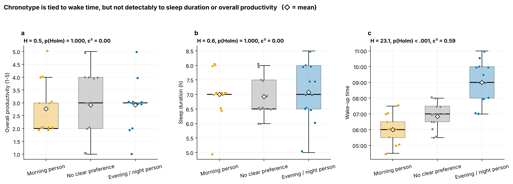
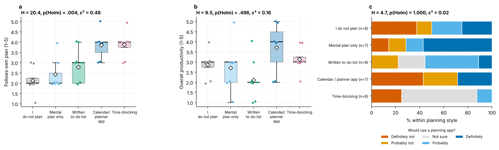
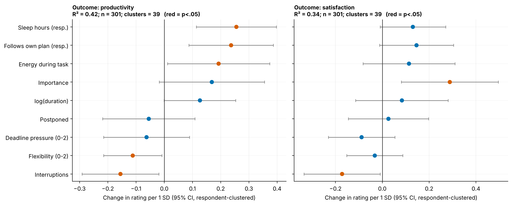

# Student time-management mini-survey: descriptive & inferential analysis

A reproducible analysis of a primary survey on how university students plan their time (39 respondents, 301 respondent × task reports):
descriptive statistics, non-parametric and cluster-robust inference, 16 Matplotlib figures, and a Jupyter notebook that regenerates everything from the cleaned data.

**Start here → [`notebooks/01_time_management_analysis.ipynb`](notebooks/01_time_management_analysis.ipynb)** (outputs are saved, so it reads on GitHub without running anything).

## Key findings
| # | Finding | Evidence |
|---|---|---|
| 1 | **Plan adherence is the most robust correlate of productivity.** People using a calendar app or time-blocking follow their plans far more than non-planners (3.9 vs 2.1 on a 1-5 scale). | Spearman ρ = 0.58 [0.32, 0.80], Holm p = .003; plan style → adherence: ε² = 0.48, Holm p = .004 |
| 2 | **Chronotype changes *when* people live, not how they perform.** Strong differences in wake time, bed time and peak time; no detectable differences in productivity, sleep length or plan adherence; no confirmed benefit of scheduling in line with chronotype. | Wake time ε² = 0.59; bed time ε² = 0.71; peak-time Cramér's V = 0.78; all outcome tests Holm p = 1.0; alignment interaction p = .12 (Holm .24) |
| 3 | **Task type shapes the day.** Energy differs most across tasks (exercise/assignments/study high; sleep/leisure/commute low); interruptions are heaviest for study and assignments. | Cluster-robust Wald p < .001 for all six outcomes; energy ε² = 0.44 |
| 4 | **Why plans fail:** phone/social media (46%), procrastination (36%), requests from others (33%), poor time estimation (31%). Timing is driven by deadlines (51%) and free time (44%) more than energy (38%). | Cochran's Q p = .002 and < .001; Wilson CIs in Fig. 3 |
| 5 | **Task-level model:** sleep hours and plan adherence are the only predictors of task productivity surviving Holm correction (R² = 0.42, task type included). Sleep is **not** related to overall productivity at the respondent level, so treat that effect as tentative. | Cluster-robust OLS; Holm p = .007 and .022 |
| 6 | **Robust to flagged cases:** excluding the 4 flagged respondents changes none of the 13 respondent-level decisions. | Section 4.5 |





> **Read the caveats.** n = 39, a near-balanced quota-style sample, self-reported and cross-sectional. Percentages describe this sample, not a population; non-significant results are low-powered, not proof of no effect. See the notebook's *Limitations* section.

## Methods in brief
| Issue | Approach |
|---|---|
| Small *n*, ordinal 1-5 ratings | Kruskal-Wallis (ε²), Mann-Whitney post-hoc, Spearman with bootstrap CIs |
| Many tests | Holm correction within pre-defined families; every test is logged in `results/tables/results_registry_all_tests.csv` |
| 301 task rows from 39 people (non-independent) | Respondent-clustered CR1 standard errors (G − 1 df), cluster bootstrap |
| Sparse contingency tables | Permutation chi-square (10,000 permutations), bias-corrected Cramér's V |
| Multiple-response items | Cochran's Q, Wilson 95% CIs |
| Data quality | Integrity assertions on load; sensitivity analysis excluding 4 flagged respondents; sparse variables (`focus_hours`, `times_per_week`) not used for inference |

The extra methods that SciPy does not provide (cluster-robust OLS, permutation χ², Cochran's Q) are implemented in [`src/tmsurvey/stats.py`](src/tmsurvey/stats.py) and unit-tested against independent formulas, so the project needs only NumPy / pandas / SciPy / Matplotlib.

## Repository layout
```
├── data/
│   ├── processed/               cleaned inputs (xlsx + 2 csv; xlsx == csv is tested)
│   └── DATA_DICTIONARY.md       variable definitions and assumptions
├── notebooks/
│   └── 01_time_management_analysis.ipynb   the full analysis, narrative + code + outputs
├── src/tmsurvey/                reusable code: config, data loading, stats, plots
├── tests/                       data-integrity + statistical unit tests (pytest)
├── figures/                     16 PNGs written by the notebook (fig01 … fig16)
├── results/tables/              17 CSVs: descriptives, test results, models, sensitivity, test registry
├── .github/workflows/ci.yml     CI: tests + execute the notebook end-to-end on every push
├── Makefile · requirements.txt · pyproject.toml · LICENSE
```

## Reproduce it
```bash
git clone <your-repo-url> && cd survey-time-management-analysis
python -m venv .venv && source .venv/bin/activate        # Windows: .venv\Scripts\activate
pip install -r requirements.txt && pip install -e .

pytest -q                                                # 13 tests
jupyter lab notebooks/01_time_management_analysis.ipynb  # Run > Run All Cells
# or headless:
make notebook                                            # re-executes and overwrites figures/ and results/tables/
```
All randomness (bootstrap, permutations, plot jitter) uses one seed, `C.SEED` in `src/tmsurvey/config.py`, so reruns give identical numbers.
Developed with Python 3.12, numpy 2.5.4, pandas 3.0.6, SciPy 1.18.1, Matplotlib 3.11.2.

## Notes on provenance
* The notebook's saved outputs were produced by executing its cells in order with a small script-based executor because Jupyter could not be installed in the offline build environment. The notebook itself is standard nbformat 4; running `make notebook` regenerates the outputs with Jupyter and should give the same numbers (if anything differs, trust your re-run and please open an issue).
* The CI workflow was written but not run in the build environment.
* Data are the cleaned survey files as supplied; the upstream cleaning is summarised in the `cleaning_report` sheet and is not repeated here. Before making a public repository, confirm the respondents consented to sharing even anonymised data.

## License
Code: MIT (replace `<YOUR NAME>` in `LICENSE`). Confirm the licence/consent position for the survey data separately.
